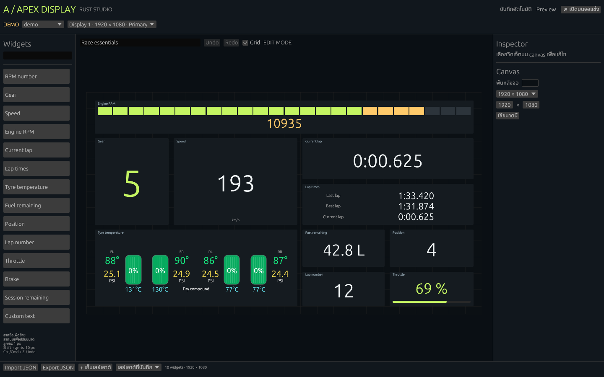

# Apex Display · Rust

แอปเดสก์ท็อป sim racing เขียนด้วย Rust ทั้ง UI และระบบเบื้องหลัง ใช้ egui/eframe ไม่มี Electron, JavaScript หรือ WebView ใน runtime



## เปิดใช้งาน

ติดตั้ง Rust stable ผ่าน [rustup](https://rustup.rs/) แล้วรันในโฟลเดอร์นี้:

```sh
cargo run --release --locked
```

Windows ต้องมี Visual Studio C++ Build Tools; macOS ต้องมี Xcode Command Line Tools (`xcode-select --install`)

macOS: สร้างไฟล์แอปด้วย `sh scripts/package-macos.sh` แล้วเปิด `release/Apex Display Rust.app` หรือใช้ ZIP ที่สคริปต์สร้าง แอปใช้ ad-hoc signing ในเครื่อง ไม่มี Developer ID/notarization

Windows แบบพร้อมใช้: แตกไฟล์ `release/Apex-Display-Rust-Windows-x64.zip` แล้วเปิด `simdisplay.exe` หรือคัดลอกไฟล์จาก `release/windows-x64/` ไปยังเครื่อง Windows x64 ไม่ต้องติดตั้ง Rust หรือ Node.js

Build บน Windows: เปิด Developer PowerShell ของ Visual Studio (พร้อม Windows SDK เพื่อเรียก `rc.exe`) แล้วรัน `cargo build --release --locked` แล้วเปิด `target/release/simdisplay.exe` มี workflow `Rust desktop builds` แบบ manual สำหรับสร้าง ZIP บน Windows/macOS โดยไม่ publish

Cross-build จาก macOS/Linux: ติดตั้ง LLVM/LLD และ [cargo-xwin](https://github.com/rust-cross/cargo-xwin) ให้เรียกได้จาก `PATH` จากนั้น:

```sh
rustup target add x86_64-pc-windows-msvc
sh scripts/package-windows.sh
```

สำหรับ Windows x86 (32 บิต):

```sh
rustup target add i686-pc-windows-msvc
sh scripts/package-windows.sh x86
```

แตก `release/Apex-Display-Rust-Windows-x86.zip` แล้วเปิด `simdisplay.exe` (portable ไม่ต้องติดตั้ง Rust หรือ Node.js) ไฟล์แยกจากรุ่น x64

สคริปต์สร้าง Windows x64 โดยค่าเริ่มต้น หรือ x86 เมื่อระบุอาร์กิวเมนต์ ด้วย MSVC target และ static C runtime แล้วแพ็ก `.exe`, คู่มือ และใบอนุญาตฟอนต์เป็น ZIP การ cross-build สำเร็จไม่ใช่การยืนยันว่าได้ทดสอบ runtime บน Windows แล้ว

## การใช้งาน

- เลือกวิดเจ็ตจากแถบซ้าย (สูงสุด 100) คลิกบน canvas เพื่อเลือก แล้วปรับที่ Inspector
- ลากชื่อเพื่อย้าย ลากมุมล่างขวาเพื่อปรับขนาด Grid snap ทีละ 8 px; คลิกมุมแล้วใช้ลูกศรเพื่อปรับขนาดด้วยคีย์บอร์ด
- ลูกศรขยับ 1 px; Shift + ลูกศร 10 px; Ctrl/Cmd + Z ย้อนกลับ และ Ctrl/Cmd + Shift + Z ทำซ้ำ (60 ขั้น)
- Ctrl/Cmd + D ทำสำเนา; Delete ลบ; ปุ่มชั้นบน/ล่างจัดลำดับซ้อน; ล็อกเพื่อป้องกันการย้าย/ย่อขยาย
- ปรับสีตัวอักษร พื้นหลัง ความโปร่งใส ฟอนต์ ขนาด และค่าเตือน ตัวเลขเวลารอบใช้มิลลิวินาที
- RPM ตั้งได้ 1–12 ช่วงสี เริ่มที่ 0 เรียงเพิ่ม ใช้หน่วย RPM หรือ % ของรอบสูงสุด มีค่าสำรองเมื่อเกมไม่ส่ง max RPM ปรับแล้วบันทึกอัตโนมัติ
- Canvas รองรับ Full HD, 1920 × 480, 480 × 1920, QHD และกำหนดเอง เปลี่ยนขนาดด้วย “ใช้ขนาดนี้”; Undo ได้
- บันทึกอัตโนมัติลงเครื่อง; “เก็บเลย์เอาต์” เก็บหลายแบบ ชื่อซ้ำจะอัปเดต
- Import/Export JSON ใช้รูปแบบ version 1 ร่วมกับแอป Electron เดิม เลย์เอาต์เก่าได้รับค่าเริ่มต้นอัตโนมัติ
- Preview ซ่อนเครื่องมือแก้ไข เลือกจอแล้วกด “เปิดบนจอแข่ง” เพื่อย้ายหน้าต่างไปเต็มจอ กด Escape กลับ editor

วิดเจ็ตทั้งหมด 22 แบบ: RPM number, Gear, Speed, Engine RPM, Current lap, Best lap, Last lap, Lap times (last/best/current), Tyres, Fuel, ERS battery energy, Electric motor power, ERS deployment mode, Position, Lap, Throttle, Brake, DRS active, Traction control, ABS, Session remaining และ Custom text

Best lap และ Last lap เป็นวิดเจ็ตเวลาแยก แสดง `นาที:วินาที.มิลลิวินาที` และ `—` เมื่อไม่มีข้อมูล ใช้เกณฑ์สีเตือนหน่วยมิลลิวินาทีได้ เลย์เอาต์ที่มีวิดเจ็ตใหม่สองแบบนี้ใช้กับแอป Rust; แอป Electron รุ่นเดิมยังไม่รู้จักชนิดวิดเจ็ตใหม่

วิดเจ็ตสถานะใหม่:

- **DRS active**: `ACTIVE` เมื่อ DRS เปิดจริง และ `OFF` เมื่อปิด อ่านจาก Car Telemetry ไม่ใช้ค่าอนุญาตเปิด DRS
- **Traction control**: `OFF`, `MEDIUM`, `FULL` ตามระดับระบบช่วยขับ
- **ABS**: `OFF`, `ON` ตามการตั้งค่าระบบช่วยเบรก

Traction/ABS เป็นการตั้งค่าระบบช่วยขับ ไม่ใช่การตรวจจับจังหวะที่ระบบแทรกแซงล้อ ตาม [สเปก EA F1 25 v3](https://forums.ea.com/t5/s/tghpe58374/attachments/tghpe58374/f1-games-game-info-hub-en/61/4/Data%20Output%20from%20F1%2025%20v3.pdf) หน้า 10–11 ค่าที่ไม่รองรับ ขาดหาย หรือหมดอายุ แสดง `—` แยกจาก `OFF` มีข้อมูล Demo สำหรับลองวางวิดเจ็ต และเลย์เอาต์ที่มีชนิดใหม่ใช้กับแอป Rust

ยางเรียง FL/FR/RL/RR: เขียวอุณหภูมิผิวยาง °C, เหลืองแรงดัน PSI, ฟ้าอุณหภูมิเบรก °C, ขาวเปอร์เซ็นต์สึก; 0% หมายถึงยังไม่สึก ค่าที่ไม่มีแสดง `—`

## Telemetry

Demo เปิดได้โดยไม่ใช้เกมและมีป้าย DEMO เสมอ

F1 25: เปิด UDP Telemetry ที่ `127.0.0.1:20777`, format **2025**, packet version 1, telemetry Public แล้วเลือก F1 25 ในแอป รองรับ Session, Lap Data, Car Telemetry, Car Status, Car Damage และ Session History ของรถผู้เล่นหลัก

ข้อมูลแต่ละค่าหมดอายุใน 2.5 วินาที ไม่มีข้อมูลจะแสดง WAITING; พอร์ตถูกใช้งานแสดง ERROR และกดเชื่อมต่อใหม่ได้ F1 fuel ใช้ kg, Demo ใช้ L; best lap ต้องเป็นรอบ valid

ACC, LMU และ iRacing ยังไม่มี receiver และแสดง NOT READY ตามขอบเขตแอปเดิม

## ข้อมูลและการกู้คืน

เก็บ `workspace.json` แยกจาก Electron ใน application data directory ของ SimdisplayRust:

- macOS: `~/Library/Application Support/local.Apex.SimdisplayRust/`
- Windows: `%APPDATA%\Apex\SimdisplayRust\data\`

ระบุโฟลเดอร์อื่นได้ด้วย `simdisplay --data-dir /path/to/folder` ไม่ย้าย Electron localStorage อัตโนมัติ ให้ Export/Import JSON แทน

หากไฟล์เสีย แอปหยุด autosave เพื่อรักษาไฟล์เดิม ปุ่ม “สำรองไฟล์เดิม แล้วเริ่มบันทึกใหม่” จะคัดลอกไฟล์เดิมเป็น `.backup-<uuid>.json` ก่อนอนุญาตให้เขียนใหม่ การบันทึกใช้ temporary file และ replace หลังเขียนเสร็จ

สร้าง default layout JSON โดยไม่เปิด UI: `simdisplay --export-default /path/to/dashboard.json`

## ตรวจสอบ

```sh
cargo fmt --check
cargo clippy --locked --all-targets -- -D warnings
cargo test --locked
cargo build --release --locked
```

ชุดทดสอบครอบคลุม JSON เดิม/เก่า, validation, geometry/RPM/history, editor interactions ผ่าน egui, packet สังเคราะห์, per-field expiry, UDP loopback และ storage recovery

สถานะการตรวจ native UI และแพ็กเกจจะบันทึกใน `docs/verification.md` การทดสอบ packet สังเคราะห์ไม่ใช่การยืนยันจาก F1 25 จริง และการ build บน macOS ไม่ใช่การทดสอบบน Windows

ฟอนต์ Noto Sans Thai และ Barlow Condensed อยู่ใน `assets/fonts` พร้อม SIL Open Font License; ไอคอนใช้ไฟล์เดียวกับโปรเจ็คเดิม

ไอคอน Windows ฝังใน `.exe` ผ่าน `build.rs` และ `assets/windows.rc` โดยใช้ `assets/icon.ico` หลายขนาด (16–256 px) ส่วนไอคอนหน้าต่างใช้ `assets/icon.png` จากภาพเดียวกัน Cross-build ต้องมี `llvm-rc` บน PATH หรือระบุ resource compiler ผ่าน `RC`

## ปรับแต่งสไตล์วิดเจ็ต

เลือกวิดเจ็ตแล้วไปที่ **Inspector → APPEARANCE**:

- **Wheel LCD**: จอแข่งพื้นเข้ม ขอบบาง มุมเหลี่ยม ฟอนต์ condensed; **Minimal**: พื้นโปร่งใส ซ่อนหัวข้อ/หน่วย; **Card**: พื้นหลังและกรอบมุมโค้ง ระยะด้านในกว้างขึ้น แสดงค่าด้วยฟอนต์ mono สีขาว ซ่อนหัวข้อ/หน่วยแบบ Minimal แต่ละปุ่มใช้กับวิดเจ็ตที่เลือกเท่านั้น
- **กรอบและระยะห่าง**: มุมโค้ง 0–100, ขอบ 0–20, สีขอบ และระยะด้านใน 0–100 (หน่วยพิกเซลบน canvas)
- **หัวข้อและหน่วย**: ซ่อนหัวข้อ ปรับสี/ขนาด และวางหัวข้อด้านบนหรือด้านล่าง หน่วยของ Speed, Fuel, Throttle และ Brake ปรับสี/ขนาดและซ่อนได้ โดยแสดงแยกด้านล่างตัวเลข
- **จัดตำแหน่งตัวเลข / ข้อความ**: ซ้าย–กลาง–ขวา และบน–กลาง–ล่าง; Tyres และแถบ RPM ใช้การจัดองค์ประกอบเฉพาะของตัวเอง ส่วน Lap times ปรับตำแหน่งค่าในแต่ละแถว
- **ไฟ RPM**: เลือกเหลี่ยม มน หรือ LED วงกลม ใช้ช่วงสี RPM และข้อมูลเดิม
- **คัดลอกสไตล์ → เลือกอีกวิดเจ็ต → วางสไตล์**: คัดลอกสี ฟอนต์ กรอบและการจัดข้อความ โดยเก็บขนาดตัวเลข ตำแหน่ง ชนิดข้อมูล ชื่อ และเกณฑ์เตือนของวิดเจ็ตปลายทาง

ทุกการเปลี่ยนสไตล์ Undo/Redo ได้และบันทึกอัตโนมัติ รวมอยู่ใน JSON ที่ส่งออก เลย์เอาต์เก่านำเข้าได้โดยมีค่าเริ่มต้นให้ สไตล์ใหม่รองรับในแอป Rust; แอป Electron เดิมไม่แสดงการตกแต่งใหม่นี้

### F1 25: 2026 Season Pack และพลังงานไฟฟ้า

เลือก `F1 25 / 2026 · UDP` ในแอป รองรับ UDP format **2025** และ **2026** (packet version 1) ที่ `127.0.0.1:20777` ตั้ง UDP เป็น On, Broadcast เป็น Off และ Your Telemetry เป็น Public

- **ERS battery energy**: พลังงานแบตเตอรี่คงเหลือหน่วย MJ สำหรับวางแผนใช้พลังงานและ Overtake
- **Electric motor power**: กำลังมอเตอร์ MGU-K หน่วย kW
- **ERS deployment mode**: NONE / MEDIUM / HOTLAP / BOOST ตาม Car Status; BOOST ไม่ใช่การยืนยันสิทธิ์ใช้ Overtake ของกติกา 2026

อ่านค่าของรถผู้เล่น รองรับ 24 คันใน format 2026 ค่าที่ไม่ถูกต้องหรือหมดอายุแสดง `—` และมีข้อมูล Demo ให้ลองวางวิดเจ็ต เลย์เอาต์ที่มีวิดเจ็ตใหม่ต้องเปิดด้วยแอปรุ่นที่รองรับ

อ้างอิง [สเปก UDP ของ EA สำหรับ 2026 Season Pack](https://forums.ea.com/blog/f1-games-game-info-hub-en/ea-sports%E2%84%A2-f1%C2%AE25-2026-season-pack-udp-specification/12187347) ไม่ได้ยืนยันด้วยแพ็กเก็ตจากเกมจริง
### วิดเจ็ตจาก F1 25 UDP output ครบ 16 ประเภทแพ็กเก็ต

เพิ่มตัวเลือกข้อมูล 402 รายการจากสเปก **Data Output from F1 25 v3.pdf** และ C++ structures ที่ผู้ใช้แนบ รวมกับ Common 22 แบบเป็น 424 ตัวเลือก ไม่รวมฟิลด์ Header ที่ใช้ระบุตัวแพ็กเก็ต

ในแถบ **Widgets** เลือกหมวดจากเมนู Common / All outputs / Motion / Session / Lap / Event / Participants / Setup / Telemetry / Status / Classification / Lobby / Damage / History / Tyre sets / Motion Ex / Time trial / Lap positions หรือพิมพ์ค้นหาชื่อข้อมูล เช่น `wing damage`, `fuel remaining`, `brake bias`, `wheel slip`, `sector` การค้นหาครอบคลุมทุกหมวด

หลังเพิ่มวิดเจ็ต เลือก **Inspector → ข้อมูลจากเกม** เพื่อเปลี่ยนรถ ล้อ รอบ หรือรายการในอาร์เรย์:

- Car ใช้รถผู้เล่นโดยอัตโนมัติ เอาเครื่องหมาย “รถผู้เล่น” ออกเพื่อเลือกหมายเลขรายการรถ (เป็นลำดับใน UDP ไม่ใช่อันดับการแข่งขัน)
- ล้อเรียงตามสเปก: #1 RL, #2 RR, #3 FL, #4 FR
- ประวัติรอบ ชุดยาง พยากรณ์อากาศ และข้อมูลที่มีหลายรายการ เลือก #1 เป็นต้นไป แต่ละวิดเจ็ตแสดงหนึ่งค่าจากรายการที่เลือก เพิ่มหลายวิดเจ็ตเพื่อเทียบรายการได้
- ข้อมูล Event ใช้ชนิดเหตุการณ์จริงเพื่ออ่าน union และล้าง payload ของเหตุการณ์เก่าเมื่อมีเหตุการณ์ใหม่ รายการที่ยังไม่ถูกส่งหรืออยู่นอกจำนวนข้อมูลจริงแสดง `—`
- Participants เก็บได้ 6.5 วินาทีเพื่อครอบคลุมความถี่ส่งทุก 5 วินาที ส่วน Event ล่าสุดและผลจบการแข่งขันเก็บจนเปลี่ยน session; ข้อมูลปกติหมดอายุใน 2.5 วินาที

**ตัวเลือกใหม่ 402 รายการใช้ UDP format 2025 ตามเอกสารที่แนบ** การรองรับ 2026 ก่อนหน้านี้ยังใช้กับวิดเจ็ต Common ที่เกี่ยวข้อง ไม่ควรนำ offsets ของปี 2025 ไปอ่านแพ็กเก็ตปี 2026 โดยตรง หน่วยตัวเลือกใหม่ตรงกับ output เช่น J และ W; Common มีตัวเลือกแปลงเป็น MJ และ kW ให้แล้ว บางรหัสที่สเปกอ้างถึง Appendix จะแสดงเป็นตัวเลขรหัส

ตัวถอดข้อมูลใช้ metadata ที่สร้างจากโครงสร้าง packed little-endian ไม่เรียกใช้โค้ดหรือคำสั่งจากเอกสาร สร้าง metadata ซ้ำได้ด้วย `python scripts/generate-f1-fields.py structures.txt assets/f1-2025-fields.json` (Python ใช้เฉพาะการสร้างไฟล์นี้ แอปจริงยังเป็น Rust)
### Assetto Corsa (เกมต้นฉบับบน Windows)

เลือก **Assetto Corsa · Shared Memory** จากเมนูแหล่งข้อมูล แล้วเข้าไปขับในสนาม แอปเชื่อมต่อและลองใหม่อัตโนมัติ ไม่ต้องตั้งพอร์ต UDP หรือติดตั้งแอป Python ลงในเกม

- อ่าน `Local\acpmf_physics`, `Local\acpmf_graphics`, `Local\acpmf_static` แบบ read-only โดยใช้ OpenFileMappingW แอปไม่สร้าง shared memory จำลองขึ้นเองขณะรอเกม
- ตรวจว่า `acs.exe` หรือ `acs_x86.exe` กำลังทำงาน เพื่อแยกจากเกมอื่นที่ใช้ชื่อ shared memory เดียวกัน เมื่อไม่พบเกมจะแสดง WAITING
- Common รองรับ Speed, Gear, RPM / max RPM, Fuel (L), Throttle, Brake, Current/Last/Best lap, Position, Lap, Session remaining, อุณหภูมิแกนยาง, แรงดันยาง, อุณหภูมิเบรก, ชนิดยาง และ DRS สำหรับรถที่รองรับ เกียร์ AC 0/1/2 ถูกแปลงเป็น R/N/1 และเวลาเป็นมิลลิวินาทีหรือวินาทีตามชนิดวิดเจ็ต
- เพิ่ม **130 ตัวเลือก** ในหมวด **AC Physics**, **AC Graphics**, **AC Static** เช่น G force, Wheel load/slip, Camber, Suspension travel, Turbo, Brake bias, KERS/ERS charge, ERS power/recovery level, ชื่อรถ สนาม ผู้เล่น ธง และสภาพสนาม เลือกล้อ FL/FR/RL/RR หรือแกน XYZ ได้ใน Inspector
- สถานะรองรับ LIVE, PAUSED, REPLAY, WAITING และ ERROR; แพ็กเก็ตที่ไม่เปลี่ยนเป็นเวลา 2.5 วินาทีจะไม่ถูกนับเป็น LIVE มีปุ่มเชื่อมต่อใหม่
- ค่า TC, ABS และ Tyre wear ของ AC แสดงผ่านตัวเลือก AC เป็นค่า raw ไม่แปลงเป็นระดับระบบช่วยขับหรือเปอร์เซ็นต์สึกแบบ F1 ส่วน Common ที่ไม่มีข้อมูลเทียบกันโดยตรงจะแสดง `—` ค่า KERS charge แปลงจาก 0–1 เป็นเปอร์เซ็นต์ แต่ไม่ใช้พลังงานที่จ่ายต่อรอบมาอ้างว่าเป็นพลังงานแบตเตอรี่คงเหลือ

ตัวเลือกทั้งหมดตอนนี้: Common 22 + F1 25 output 402 + Assetto Corsa 130 = **554 รายการ** การรองรับนี้เป็นเกม Assetto Corsa ต้นฉบับ; ACC / EVO / Rally ยังไม่มี receiver ของตัวเอง

อ้างอิงรูปแบบ pack(4), UTF-16 และโครงสร้าง AC จาก [Shared Memory Reference](https://www.assettocorsamods.net/threads/doc-shared-memory-reference.58/) และ [Rombik's sim_info.py ในแอปของ Custom Shaders Patch](https://github.com/ac-custom-shaders-patch/acc-extension-apps/blob/master/apps/python/AccExtHelper/sim_info.py) สร้าง metadata ซ้ำได้ด้วย `python scripts/generate-ac-fields.py sim_info.py assets/ac-fields.json` ตัวสร้างอ่าน AST เท่านั้น ไม่ import หรือรันไฟล์ต้นทาง